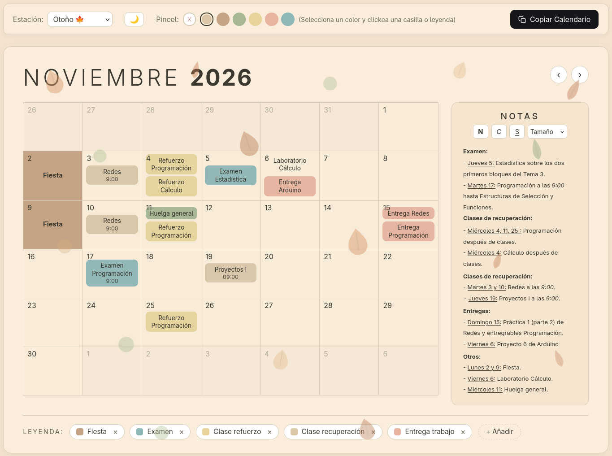

[](docs/imagenes/Banner_Github.jpg)

# Editor Calendario

**Editor Calendario** es una aplicación web para crear a mano el calendario del mes: escribes tus eventos, los pintas con colores, añades una leyenda y notas con formato, y al final copias el mes como una imagen limpia para compartirlo o imprimirlo.

Nació como agenda de la universidad —asignaturas, entregas, exámenes, horarios—, pero sirve para cualquier mes que quieras organizar a tu manera.

Todo funciona **en tu ordenador**: no hay cuentas, no hay nube y nada viaja a un servidor de terceros.

<!-- Captura del proyecto:

Para publicarla, guarda la imagen como `docs/imagenes/captura.png` y descomenta esta línea:



-->

---

## 📋 Qué puedes hacer

| Función | Qué hace |
|---------|----------|
| **Cuadrícula mensual** | Un mes completo, de lunes a domingo, con casillas en las que puedes hacer clic |
| **Eventos** | Título, hora opcional (con selector de horas y minutos) y color. Pueden pintar toda la casilla o quedar sin fondo, solo con el texto |
| **Eventos de varios días** | Con **Hasta**, el evento se dibuja en todo el rango. Los rangos van en una franja propia, pegada arriba de la casilla |
| **Eventos que se repiten** | Cada semana (eligiendo qué días de la semana y cada cuántas semanas) o cada mes (mismo día del mes) |
| **Límite de repeticiones** | Campo **Repetir (veces)** para que una serie no siga para siempre. Vacío = sin límite |
| **Borrar una repetición** | Si borras una ocurrencia, desaparecen esa y las siguientes; las anteriores se quedan como estaban |
| **Arrastrar y soltar** | Mueves un evento de una casilla a otra, y los rangos se desplazan enteros |
| **Deshacer** | `Ctrl+Z` revierte el último cambio de eventos o de leyenda |
| **Leyenda fija** | Una sola lista de categorías compartida por todos los meses: crear, renombrar, recolorear y borrar |
| **Pincel** | Pintas casillas con el color elegido; el `✕` significa "sin fondo" y limpia el color |
| **Notas del mes** | Bloque de notas por mes con negrita, cursiva, subrayado, tres tamaños de letra y sublistas con `Tab` |
| **Estaciones** | Cuatro ambientaciones que cambian el tono del fondo, las casillas y las notas, con decoraciones pastel |
| **Modo oscuro** | Tema claro u oscuro, se guarda con el calendario |
| **Copiar calendario** | Exporta el mes como PNG limpio, sin botones ni menús, directo al portapapeles |
| **Guardado automático** | Todo se guarda solo; al volver a abrir está igual |

---

## 🚀 Puesta en marcha

### Lo que necesitas

- **Windows** para el arranque con doble clic (el resto también funciona en cualquier sistema con Node).
- **Node.js 18 o superior** ([descárgalo desde nodejs.org](https://nodejs.org/), versión LTS).
- Un navegador moderno (Chrome, Edge, Firefox, Brave…).

### Primera vez (una sola vez)

1. Descarga o clona la carpeta del proyecto.
2. Abre una terminal **dentro de la carpeta** y ejecuta:

   ```bash
   npm install      # instala las dependencias
   npm run build    # compila la app en dist/
   ```

> La carpeta `dist/` es la versión compilada que sirve el servidor local, y no se sube al repositorio: por eso este paso hace falta siempre que la app haya cambiado o después de clonar el proyecto.

### Arrancar el calendario

**Haz doble clic en `abrir-calendario.bat`.**

El archivo lo hace todo: libera el puerto si ha quedado un servidor antiguo abierto, levanta el servidor local y abre el calendario en el navegador en <http://localhost:5173>.

La ventana negra que se abre **es el servidor**. Mientras esté abierta, cada cambio se escribe también en `datos-calendario.json`. Si la cierras, la pestaña que ya tenías abierta sigue funcionando y guarda en el navegador, pero al recargar la página no volverá a cargarse: vuelve a abrir el `.bat`.

¿Quieres un acceso directo con el icono del calendario? Crea un acceso al `.bat` y asígnale `public/favicon.ico` como icono.

### Modo desarrollo

Si quieres tocar el código con recarga automática:

```bash
npm run dev        # servidor de desarrollo de Vite
npm run build      # compilación final (TypeScript + Vite)
```

---

## 🖱️ Cómo se usa

### Navegación

| Acción | Resultado |
|--------|-----------|
| `‹` / `›` en el título | Mes anterior / siguiente |
| Haz clic en el fondo de una casilla | Crea un evento en ese día |
| Haz clic sobre un evento | Abre el diálogo para editarlo o borrarlo |
| Arrastra un evento | Lo mueves a otro día (un rango se mueve completo) |
| `Ctrl+Z` | Deshace el último cambio de eventos o de leyenda |
| Haz clic en el nombre de la leyenda | Edita esa categoría |
| Haz clic en la muestra de color de la leyenda (con un color de pincel elegido) | Recolorea esa categoría con el color del pincel |

### Crear un evento

En el diálogo rellenas:

- **Título** (obligatorio) y **Hora** opcional.
- **Hasta**: si el evento dura varios días, se pinta en todo el rango.
- **Repetir**: sin repetición, **cada semana** o **cada mes**.
  - En modo semanal aparece **Cada (semanas)** —por ejemplo 2, para que caiga una semana sí y otra no— y los días **L M X J V S D** donde quieres que caiga.
  - **Repetir (veces)** limita la serie: 5 significa cinco ocurrencias y nada más. Vacío = para siempre.
- **Color**, **Colorear toda la casilla** o **Sin fondo**.

> Cuando editas una ocurrencia se edita **toda la serie**. Cuando **borras** una ocurrencia, se borran esa y las siguientes: las anteriores quedan intactas. Si borras la primera, desaparece el evento entero.

### Herramientas de la barra superior

| Herramienta | Para qué sirve |
|-------------|----------------|
| **Estación** | Cambia la ambientación (Primavera, Verano, Otoño, Invierno) |
| **Modo oscuro** | Alterna entre tema claro y oscuro |
| **Pincel** | Eliges un color; con `✕` limpias el color y los eventos nacen "sin fondo" |
| **Copiar Calendario** | Genera el PNG del mes y lo copia al portapapeles (si el navegador lo bloquea, lo descarga) |

### Notas del mes

Cada mes tiene su propio bloque de notas, con un guion al principio de cada línea.

| Tecla / botón | Acción |
|---------------|--------|
| `N` / `C` / `S` | Negrita / Cursiva / Subrayado |
| Selector **Tamaño** | Pequeña, Normal o Grande sobre el texto seleccionado |
| `Tab` / `Shift+Tab` | Anida o desanida la línea actual (hasta 3 niveles) |
| `Enter` | Nueva línea con guion, heredando el nivel de la anterior |
| Clic fuera | El texto se guarda solo |

---

## 💾 Dónde quedan tus datos

Se guardan en dos sitios, y los dos son tuyos:

1. **`datos-calendario.json`**, en la misma carpeta del proyecto: lo escribe el servidor local cada vez que cambias algo.
2. **El almacenamiento del navegador**, para que la app se abra al instante aunque el servidor no esté.

Si el navegador borra sus datos (o abres una ventana privada), el archivo `.json` es el que te salva: al arrancar, la app compara ambos y toma la versión más nueva.

Para hacer una copia de seguridad, copia `datos-calendario.json`. Para llevarte el calendario a otro ordenador, copia la carpeta completa junto con ese archivo.

---

## 🎨 Estaciones

Cada estación cambia la cara del calendario sin tocar tus eventos ni tus notas:

| Estación | Ambiente |
|----------|----------|
| 🌸 **Primavera** | Fondo verde suave, flores y mariposas |
| ☀️ **Verano** | Fondo dorado, soles, nubes y helados |
| 🍂 **Otoño** | Fondo arena, hojas y calabazas |
| ❄️ **Invierno** | Fondo azul claro, copos y regalos |

Las decoraciones se reparten sobre la cuadrícula y **no** aparecen en el PNG: la captura queda limpia, solo con tu calendario.

---

## 🔧 Problemas comunes

| Síntoma | Solución |
|---------|----------|
| "Falta la versión compilada" | Ejecuta `npm run build` en la carpeta del proyecto |
| El navegador no abre nada en `localhost:5173` | Cierra la ventana del servidor y vuelve a hacer doble clic en el `.bat` (el `.bat` ya libera el puerto) |
| Cambio el código y no veo los cambios | El servidor sirve `dist/`: vuelve a compilar con `npm run build` |
| He perdido los eventos al borrar los datos del navegador | Revisa `datos-calendario.json`: la app lo usa como respaldo |

---

## 🗂️ Estructura del proyecto

```
Editor calendario/
├── index.html              # Punto de entrada HTML
├── server.mjs              # Servidor local + guardado en datos-calendario.json
├── abrir-calendario.bat    # Doble clic: arranca el servidor y abre el navegador
├── package.json            # Dependencias y scripts
├── tsconfig.json           # Configuración de TypeScript
├── datos-calendario.json   # Tus datos (se crea solo, no se sube al repo)
├── dist/                   # Versión compilada que sirve el servidor (no se sube al repo)
├── docs/
│   └── imagenes/           # Banner del README
├── public/
│   ├── favicon.svg         # Icono de la pestaña
│   └── favicon.ico
└── src/
    ├── main.ts             # Arranque y eventos de la interfaz
    ├── calendar.ts         # Lógica de fechas, cuadrícula y repeticiones (pura)
    ├── render.ts           # Dibujo de casillas, leyenda y notas
    ├── state.ts            # Estado de la app y persistencia
    ├── decorations.ts      # Decoraciones SVG por estación
    ├── capture.ts          # Exportación PNG limpia
    └── style.css           # Estilos y variables por estación
```

---

## 🧱 Tecnología

[Vite](https://vite.dev/) + [TypeScript](https://www.typescriptlang.org/) sin frameworks, y [html-to-image](https://github.com/bubkoo/html-to-image) para exportar el PNG. El servidor local usa solo módulos nativos de Node, sin dependencias extra.

---

*Arma tu mes, píntalo a tu manera y compártelo como imagen.* 🗓️
