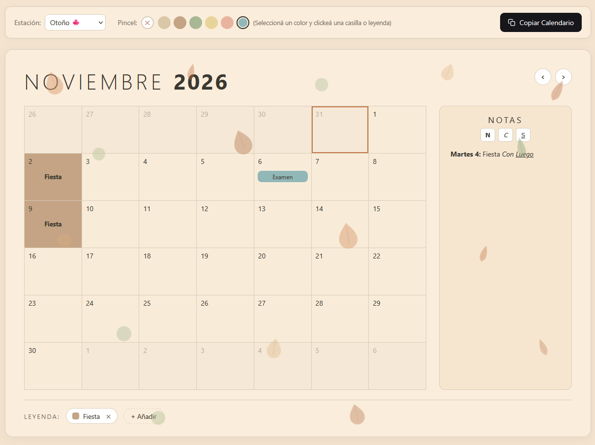
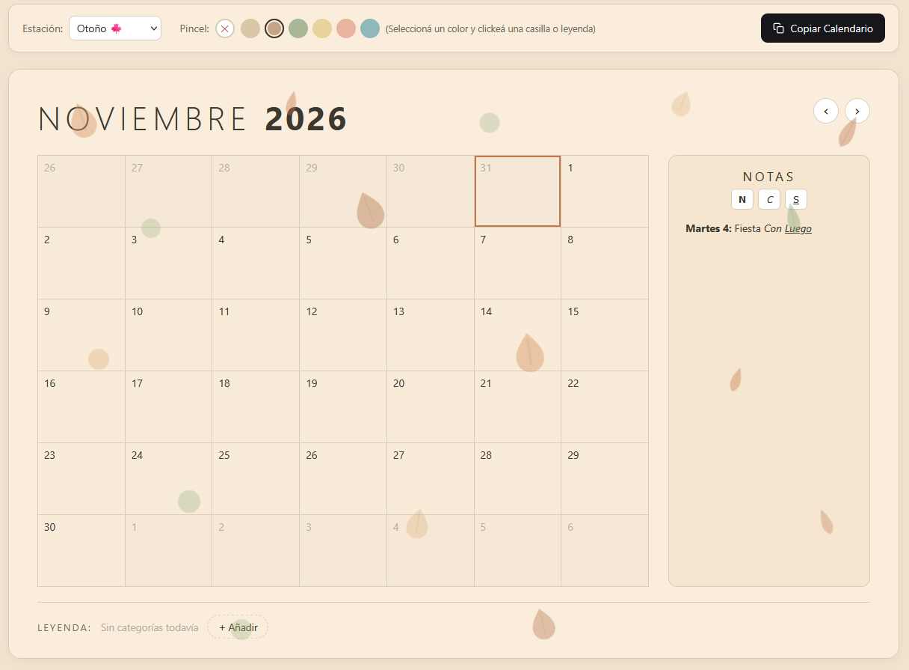
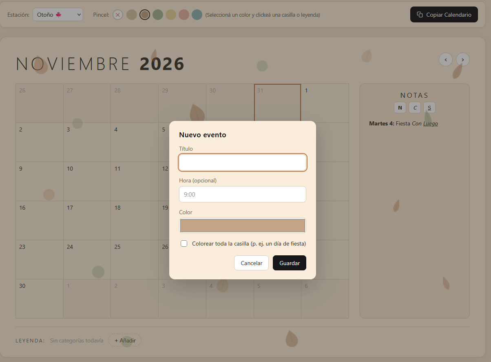
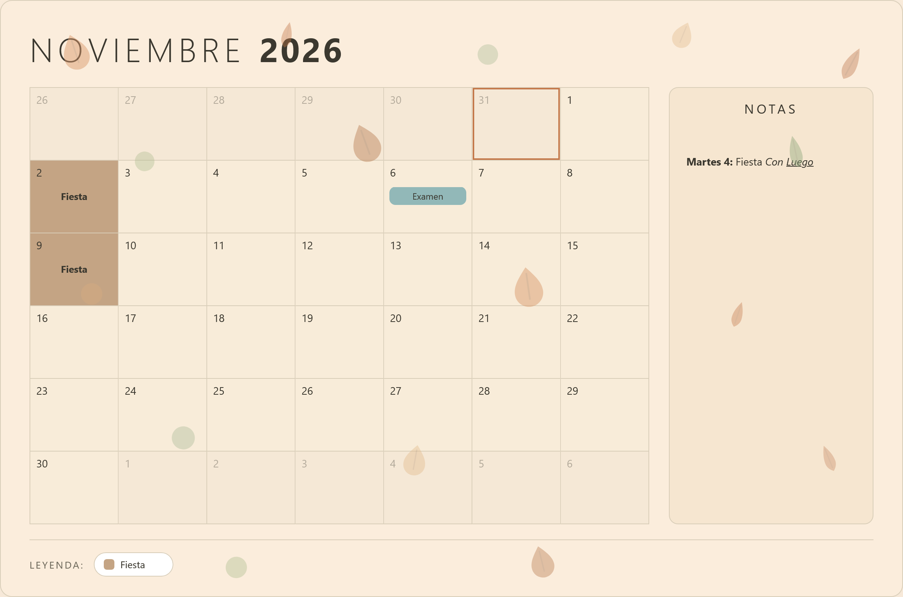

**Editor Calendario** es una aplicación web para armar calendarios mensuales a mano, hecha pensando en planificar tareas de la universidad. Creas eventos, los pintas con colores, agregas leyendas y notas con formato, y al final copias el calendario completo como una imagen limpia para compartirlo.

Está desarrollada con [Vite](https://vite.dev/) y [TypeScript](https://www.typescriptlang.org/) (sin frameworks), y usa [html-to-image](https://github.com/bubkoo/html-to-image) para exportar el resultado.

---

## 🎯 Funcionalidades principales

| Categoría | Descripción |
|-----------|-------------|
| **Grilla mensual** | Vista de un mes completo, de lunes a domingo, con celdas editables |
| **Eventos** | Título, hora opcional y color; el evento de casilla completa queda siempre arriba |
| **Estaciones** | Cuatro temporadas que retintan fondo, celdas y notas, con decoraciones SVG pastel |
| **Leyenda por mes** | Categorías propias de cada mes: se agregan, borran y recolorean con el pincel |
| **Notas con formato** | Bloque de notas por mes con negrita, cursiva y subrayado |
| **Copiar calendario** | Exporta el mes como PNG limpio (sin botones ni menús) al portapapeles |
| **Persistencia** | Todo se guarda solo en tu navegador; al volver a abrir está igual |

---

## ⌨️ Cómo usarlo

### Navegación

| Elemento | Acción |
|----------|--------|
| `‹` `›` | Mes anterior / siguiente |
| Clic en una celda vacía | Agregar un evento en ese día |
| Clic sobre un evento | Editarlo o borrarlo |

### Herramientas de la barra

| Herramiento | Acción |
|-------------|--------|
| **Estación** | Cambiar entre Primavera, Verano, Otoño e Invierno (retinte + decoraciones) |
| **Pincel** | Pintar casillas con el color elegido; con `✕` se limpia el color |
| **Copiar Calendario** | Captura el mes como PNG y lo copia al portapapeles (si el navegador bloquea, lo descarga igual) |

### Notas del mes

| Tecla | Acción |
|-------|--------|
| `N` | Negrita |
| `C` | Cursiva |
| `S` | Subrayado |

---

## 🎨 Estaciones

Cada estación cambia toda la cara del calendario, sin tocar tus eventos ni tus notas:

| Estación | Ambiente |
|----------|----------|
| 🌸 **Primavera** | Fondo verde suave, flores y mariposas |
| ☀️ **Verano** | Fondo dorado, soles, nubes y helados |
| 🍂 **Otoño** | Fondo arena, hojas y calabazas |
| ❄️ **Invierno** | Fondo azul claro, copos y regalos |

Las decoraciones se reparten sobre toda la grilla y no se exportan al PNG: la captura queda limpia, solo con tu calendario.

---

## 📸 Capturas

[](docs/imagenes/01-vista-principal.png)

[](docs/imagenes/02-otono.png)

[](docs/imagenes/03-dialogo-evento.png)

[](docs/imagenes/04-copia-limpia.png)

---

## 🗂️ Estructura del proyecto

```
Editor calendario/
├── index.html            # Punto de entrada HTML
├── package.json          # Dependencias y scripts
├── tsconfig.json         # Configuración de TypeScript
├── abrir-calendario.bat  # Acceso directo (doble clic → servidor + navegador)
├── docs/
│   └── imagenes/         # Capturas de este README
└── src/
    ├── main.ts           # Arranque y eventos de la interfaz
    ├── calendar.ts       # Lógica de fechas y grilla (pura)
    ├── render.ts         # Dibujo de celdas, leyenda y notas
    ├── state.ts          # Estado de la app y persistencia
    ├── decorations.ts    # Decoraciones SVG por estación
    ├── capture.ts        # Exportación PNG limpia
    └── style.css         # Estilos y variables por estación
```

---

## 🚀 Cómo ejecutarlo

Hacé doble clic en `abrir-calendario.bat`. Arranca el servidor y abre el calendario en el navegador solo.

---

*Armá tu mes, pintalo a tu manera y compartilo como imagen.* 🗓️
